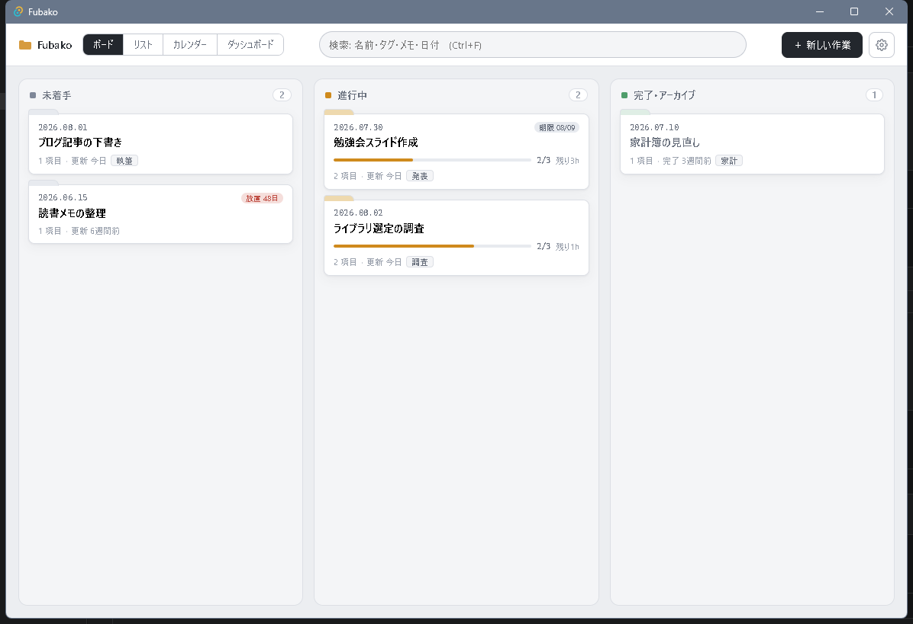
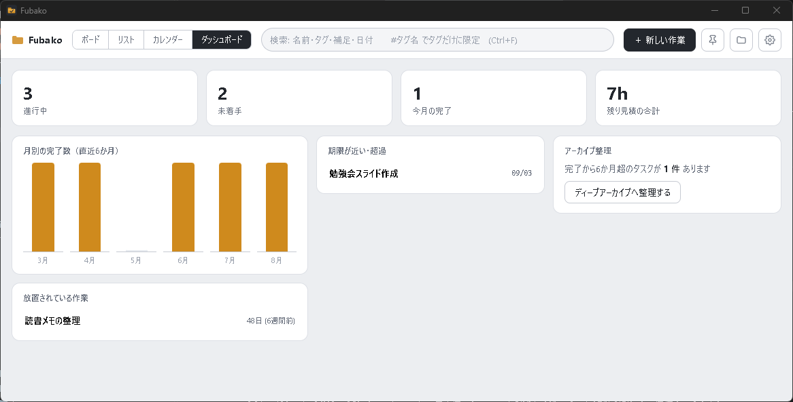
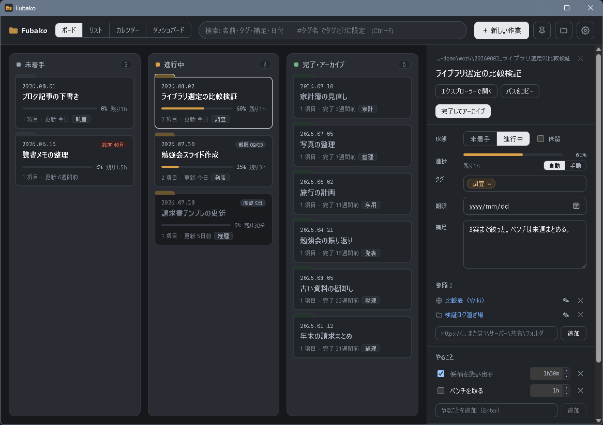
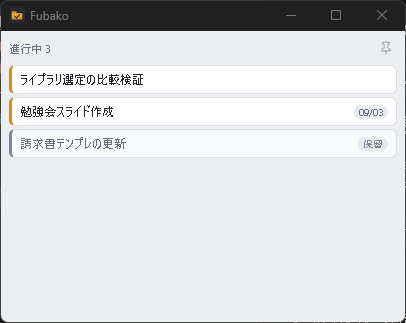

<p align="center">
  
</p>

<h1 align="center">Fubako（文箱）</h1>

<p align="center">作業フォルダを、そのままタスクに。</p>

<p align="center">
  <a href="https://github.com/Taka-S-dev/fubako/releases/latest">
    
  </a>
  <a href="https://github.com/Taka-S-dev/fubako/actions/workflows/ci.yml">
    
  </a>
</p>

<p align="center">
  <a href="https://github.com/Taka-S-dev/fubako/releases/latest"><strong>Windows 版をダウンロード</strong></a>
</p>

Fubako は、作業ディレクトリ内のフォルダをタスクとして管理する Windows 向け常駐アプリです。

「作業ごとに `20260802_調査` のような日付フォルダを作り、資料をそこに集め、終わったらアーカイブへ移す」— この運用をエクスプローラーの手作業からそのまま引き継ぎ、カンバン・検索・進捗管理を上に載せています。



## 特徴

**フォルダ = タスク。データベースは持たない。**
タスクの実体はただのフォルダで、メタデータ（状態・タグ・期限・補足・やること）は各フォルダ直下の `.todo.json` に保存されます（サイドカー方式）。エクスプローラーで移動・リネームしてもデータは追従し、アプリを消してもデータは JSON として残ります。

作業名を変更するとフォルダ名そのものが変わります（日付は維持）。表示名を別に持たないので、アプリで見えている名前とエクスプローラーのフォルダ名が食い違うことがありません。

**完了 = 物理移動。**
タスクを完了すると、フォルダごとアーカイブディレクトリへ年別（`archive/2026/…`）に移動します。誤操作はワンクリックで復帰できます。さらに古い完了タスクは「ディープアーカイブ」（普段のスキャン・検索の対象外のコールドストレージ）へ退避できます。過去の作業を思い出したいときは、検索中に「ディープアーカイブも探す」を押せば、その場でだけ読んで探します。見つかったものは完了・アーカイブ列の下（リストでは表の末尾）に別の区切りで並び、押すと右に中身（補足・やること・参照・フォルダの中身）が読み取り専用で出ます。書き換えたいときは作業に戻します。1件ずつでも、一定期間を過ぎたものの一括でも、どちらも確認付きです。退避したフォルダをウィンドウへドロップすれば、いつでも作業として引き戻せます。

**ファイルシステムが主、アプリは従。**
作業ディレクトリを監視しているため、エクスプローラーで直接フォルダを作ってもアプリに即反映されます。逆に管理外のフォルダをウィンドウへドロップすれば、確認のうえ作業ディレクトリへ取り込みます。

## 機能

- **4つのビュー**: カンバンボード（ドラッグ&ドロップでステータス変更・アーカイブ移動）／ソート・フィルタ付きリスト／月カレンダー（開始・期限・完了を表示）／ダッシュボード（統計・月別完了数・放置検出・期限アラート）
- **進捗管理**: やること（サブタスク）と任意の見積時間から進捗率を自動計算（時間重み付き）。残り時間の合計も表示。手動入力モードへの切り替えも可能
- **横断検索**: フォルダ名・タグ・補足・やること・参照・フォルダ内のファイル名を、アーカイブ済み含めてインクリメンタル検索。サブフォルダの中のファイルも対象です。`#タグ名` でタグだけに限定、`-語` でその語を含むものを除外でき、`#調査 ライブラリ -test` のように組み合わせられます。カードに出ていない場所（補足・やること・参照・ファイル名）で一致したときは、どこに当たったのかをカードに表示します
- **タグ**: チップで追加・削除。既存のタグを使用頻度順に候補表示するので、`執筆` と `ライティング` のような表記ゆれが起きにくくなっています
- **放置検出**: フォルダ内ファイルの最終更新から一定日数動きのないタスクを可視化
- **保留**: 回答待ちなどで手を止めている作業に印を付けられます。状態とは別軸なので未着手・進行中のどちらでも使え、保留中は放置として数えません（手の打ちようがない警告が溜まらないようにするため）。カードは色を落として一覧の中で沈みます。一覧から外したいときは、検索欄の隣の漏斗から「保留を非表示」を選びます。効いている間は漏斗に外した件数が小さく付くだけで、検索欄は空いたままなので、その上にさらに文字で絞れます。この絞り込みは保存せず、次回起動時には必ず全件表示に戻ります（放置検出から外れている保留が、誰にも気づかれない場所へ落ちないようにするため）。検索欄に直接 `-保留` と打っても同じ条件になります
- **常駐**: トレイ常駐（閉じるとトレイへ）、グローバルホットキー `Ctrl+Alt+E` で即呼び出し、クイック作成（今日の日付フォルダ＋テンプレート展開）、サインイン時自動起動、多重起動防止
- **付箋モード**: 最前面に固定して細く縮めると、進行中の作業だけを並べた細い一覧に切り替わります。行をクリックすればフォルダが開き、右クリックでその作業の参照も開けます。幅を戻せば通常の画面に戻ります
- **ダークモード**: 既定では Windows の外観設定に従い、切り替えれば再起動せず即座に反映されます。設定でライト／ダークに固定することもできます
- **期限の書き出し**: 期限つきで終わっていない作業を Obsidian の Tasks プラグインの書き方で1つの md に書き出します。Vault に置けば、Tasks の一覧や期限を見張るプラグインに Fubako の期限が並びます（一方通行）
- **参照**: 共有フォルダのパスや Wiki・チケットの URL など、フォルダに入れられない置き場所を作業ごとに何件でも登録できます。クリックで既定のアプリが開き（`https://` はブラウザ、`\\サーバー\共有` はエクスプローラー）、右クリックでコピーできます。表示名を付ければ長いパスも一覧で読めます。受け付けるのは http/https とドライブ・共有フォルダのパスだけで、プログラムを指す場合は実行前に確認します（`.todo.json` はフォルダごと受け渡せるため、黙って起動しないようにしています）
- **フォルダの中身**: サブフォルダの中まで一覧に並び、種類アイコンと相対パスで表示されます。クリックすれば拡張子の関連付けに従って開くので、`メモ.md` は普段のエディタで開きます（エディタもプレビューも内蔵しません）
- **よく使う場所**: 一時置きや共有の資料置き場など、タスクに属さないフォルダをトップバーから開けます。作業ディレクトリとアーカイブは設定不要で常に一覧に出ます
- **複数選択と一括操作**: Ctrl クリックで拾い、Shift クリックで範囲、`Ctrl+A` で表示中すべて。選ぶと上部に操作バーが出て、まとめて完了・作業に戻す・ディープアーカイブへ移動・タグの付け外しができます。移動は1件ずつ試すので、開いているファイルがあるなどで失敗したものだけが選択に残り、原因を片付けてからやり直せます
- **エクスプローラー連携**: タスクからワンクリックでフォルダを開く／パスをコピー。カードのダブルクリックでも開きます。同じフォルダのウィンドウが既にあれば、新しく開かずにそれを前面に出すので同じ窓が積み上がりません。カードとファイルは右クリックからも操作できます


<table>
  <tr>
    <td width="50%"></td>
    <td width="50%"></td>
  </tr>
  <tr>
    <td align="center">放置・期限・整理候補が数で出るダッシュボード</td>
    <td align="center">詳細パネル（やること・参照・保留）とダークモード</td>
  </tr>
</table>

<p align="center">
  <br />
  幅を詰めると、進行中だけを並べた付箋になる
</p>

## インストール

[最新のリリース](https://github.com/Taka-S-dev/fubako/releases/latest)から、どちらかをダウンロードしてください（[過去のリリース一覧](https://github.com/Taka-S-dev/fubako/releases)）。

| ファイル | 用途 |
|---|---|
| `Fubako.exe` | インストール不要。ダウンロードしてそのまま起動できます |
| `Fubako_x.y.z_x64-setup.exe` | インストール版。スタートメニューへの登録とアンインストーラーが付きます |

動作環境は Windows 10 以降です。画面の描画に WebView2 ランタイムを使います。Windows 11 には標準で含まれており、入っていない環境ではインストーラー版が導入します（ポータブル版は導入しないため、起動しない場合はインストーラー版を使うか、Microsoft が配布している WebView2 ランタイムを入れてください）。

コード署名をしていないため、ダウンロードした exe には SmartScreen の警告が出ます。組織で管理された PC では、警告ではなく起動そのものが止められることがあります。その場合はファイルのプロパティで「許可する」にチェックを入れてください。

## 使い方

**1. 2つのフォルダを指定する**

初回起動時に「作業ディレクトリ」と「アーカイブ先」を選びます。前者は作業中のフォルダを置く場所、後者は完了したフォルダの移動先です。**既に使っているフォルダをそのまま指定できます** — 中にあるフォルダは自動的にタスクとして読み込まれ、アプリ用の初期化やファイルの追加は必要ありません。

**2. 作業を作る**

「＋ 新しい作業」（`Ctrl+N`）で名前を入れると、`20260802_調査` のように今日の日付が付いたフォルダが作られます。あとは資料をそのフォルダへ入れていくだけです。エクスプローラーで直接フォルダを作っても、監視しているので一覧に自動で現れます。

**3. 進み具合を記録する（任意）**

カードを選ぶと詳細パネルが開き、やること・見積時間・期限・タグ・補足を付けられます。やることを消化すると進捗率が自動で計算されます。何も入力しなくても、フォルダの最終更新から「放置」は検出されます。 パネルは左端をドラッグして広げられ（ダブルクリックで元の幅）、補足の欄は書いた量に合わせて縦に伸びます。「補足」の見出しの下の拡大ボタンを押すとウィンドウいっぱいの編集画面が開き、調査の経緯などを長く書けます（`Ctrl+S` で保存、`Esc` で閉じる。閉じても書いた内容は消えません）。折り返さない表示にも切り替えられます。

**4. 終わったらアーカイブへ**

「完了してアーカイブ」を押すか、カードを完了カラムへドラッグすると、**フォルダごと**アーカイブ先へ年別に移動します。戻したくなったら「作業に戻す」で元の場所へ戻せます。

## 壊さない仕組み

実際のファイルを動かす道具なので、「失敗しても手元のデータが無傷であること」を設計の前提にしています。

- **移動はどの段階で失敗しても移動元が無傷。** 同一ボリュームは rename、別ボリュームは「コピー → 移動先を確定 → 最後に移動元を削除」の順で行います。コピーが途中で失敗した場合は移動元に触れずに中止します
- **開いているファイルがあるときはコピーへ退避しない。** Windows は中のファイルが開かれているとフォルダを移動できません。そこでコピーに進むと、コピーは成功しても削除に失敗して同じフォルダが2箇所に残るため、別ボリュームを示すエラーのときだけコピーを使います
- **`.todo.json` はアトミックに置き換える。** 一時ファイルへ書き切り、ディスクへ確定させてから rename で差し替えます。途中で中断しても、読み手が目にするのは書き換え前か書き換え後のどちらかです
- **後から保存したほうが、ほかでの変更を消さない。** 画面は読んだときの `.todo.json` の中身から指紋を作って持ち、保存のときに今のファイルと比べます。食い違えば書かずに読み直し、開いている詳細の欄も取り直します（書きかけの補足は残します）。エディタで直した場合も、ほかの道具が書いた場合も見分けられ、書く側に決まりは要りません
- **読めない記録は上書きしない。** 手で直している途中などで JSON が崩れていても一覧には出しますが、そのファイルへは書き込みません。初期値で上書きすると中身が失われるためです
- **外から画面を動かすリンクは、表示を変えることしかできない。** `fubako://` のリンクは既定で無効で、設定でオンにしたときだけ受け付けます。Web ページからも踏めるため、作業を選ぶ・検索欄に言葉を入れる以外の操作を受け付けず、決まった形以外は読まずに断ります（[画面を動かす](#画面を動かすfubako-のリンク)）
- **パスは実体で検証する。** `canonicalize` で `..`・シンボリックリンク・ジャンクションを解決してから管理ルート配下かを判定するため、文字列上の細工が効きません
- **破綻する設定を保存時に拒否。** 作業ディレクトリとアーカイブ先が同一、作業ディレクトリがアーカイブ先の内側にある、といった組み合わせを弾きます（`C:\work` と `C:\work\archive` のようにアーカイブ先を作業ディレクトリの直下に置く構成は、想定された使い方として動作します）
- **Fubako 自身はネットワーク通信をしません。** テレメトリも自動更新もなく、HTTP クライアントを依存に含みません。ただし、画面の表示に使う WebView2（Microsoft Edge の部品）は、Microsoft のサーバーと通信することがあります（動かしているときに接続を確認しています）。これは Fubako のコードの外で行われます

これらの性質は Rust のユニットテスト78件で固定しており、CI で毎回検証しています（ファイルを開いたままリネームした場合の挙動も含む）。検索の絞り込みや工数入力の解釈といった画面側のロジックにも、別途43件のテストがあります。

## キーボード操作

| キー | 動作 |
|---|---|
| `Ctrl+Alt+E` | どこからでも呼び出し（グローバル。設定で変更可） |
| `Ctrl+N` | 新しい作業を作成 |
| `Ctrl+F` または `/` | 検索へフォーカス |
| `Ctrl+W` | トレイへ格納（閉じるボタンと同じ） |
| `↑` `↓` | 作業の選択を移動（検索欄からそのまま一覧へ入れます） |
| `←` `→` | ボードの列を移動 |
| `Enter` | 選択中の作業をエクスプローラーで開く |
| `Ctrl`+クリック | 一括操作の対象に足す・外す |
| `Shift`+クリック | 直前に触れたものからの範囲を対象にする |
| `Ctrl+A` | 表示中のものをすべて対象にする |
| `Esc` | 選択解除 → 絞り込み解除 → トレイへ格納（モーダルが開いていれば先に閉じる） |
| `↑` `↓` `Enter` | タグ候補の移動と確定（タグ入力中） |

## 設定

| 項目 | 既定 | 説明 |
|---|---|---|
| 作業ディレクトリ | 未設定 | 監視してタスクとして並べるフォルダ |
| アーカイブ先 | 未設定 | 完了時の移動先。年別に整理されます |
| ディープアーカイブ先 | 未設定 | 古い完了タスクの退避先。普段のスキャン・検索の対象外（検索中に頼めば探せる） |
| 整理の目安 | 6か月 | 完了からこの期間を過ぎたものを整理候補にする |
| 呼び出しホットキー | `Ctrl+Alt+E` | 空欄で無効化 |
| 外観 | 自動 | ライト／ダーク。自動は Windows の設定に従う |
| 放置とみなす日数 | 14日 | この期間更新の無いタスクに印を付ける |
| 新規作成テンプレート | `メモ.md` | 作成時に展開するファイル・フォルダ（末尾 `/` でフォルダ） |
| fubako:// のリンク | 無効 | ほかのアプリやノートのリンクから、作業を開く・検索欄に言葉を入れる（[画面を動かす](#画面を動かすfubako-のリンク)） |
| 期限の書き出し先 | 未設定 | 期限つきの作業を Tasks プラグインの書き方で書き出す md（[期限の書き出し](#期限の書き出し)）。保留中を含めるかも選べる |
| よく使う場所 | 未設定 | トップバーから開けるフォルダ（1行1つ） |
| 絞り込み | 未設定 | 漏斗から選べる絞り込み（1行1つ、`名前 = 検索語`）。選ぶと一覧に効き、検索欄とは別に重ねられます。検索欄に入れた条件は漏斗の「いまの検索を保存」でそのまま追加できます。「保留を非表示」は設定不要 |

## 技術構成

| レイヤ | 技術 |
|---|---|
| シェル | [Tauri 2](https://tauri.app/)（Rust） |
| フロントエンド | SvelteKit / Svelte 5 (runes) + TypeScript |
| ファイル監視 | notify クレート（デバウンス付き） |
| データ | フォルダ内 `.todo.json`（サイドカー）＋ `%APPDATA%` の設定 JSON |

常駐アプリとして軽量であることを重視し、Electron ではなく Tauri（WebView2）を採用しています。

## ソースからビルドする

```sh
npm install
npm run tauri dev    # 開発起動
npm run tauri build  # インストーラー作成 (src-tauri/target/release/bundle/)
```

要件: Node.js / Rust ツールチェーン / Windows 10+（WebView2）

## データの持ち方

```
作業ディレクトリ/
├── 20260802_障害調査/
│   ├── .todo.json      ← 状態・タグ・期限・やること・参照等
│   └── （作業ファイル）
└── …

アーカイブ/
└── 2026/
    └── 20260601_完了済みの調査/
```

進捗率は保存せず、やることと見積から表示のたびに導出します。保存されるのは事実（何が済んだか・見積は何分か）だけです。

### `.todo.json`

専用の形式ではなく、ただの JSON です。フォルダ名（`20260802_障害調査`）が日付と作業名を、
置かれている場所が完了かどうかを表し、残りがこのファイルに入ります。全ての項目が省略可能で、
無ければ既定値として読まれます。

| キー | 型 | 内容 |
|---|---|---|
| `v` | `number` | 形の版。今は `1`。無ければ `1` とみなす |
| `id` | `string` | 作業の id（UUID）。一度振ったら変えない |
| `status` | `"backlog"` \| `"doing"` \| `"done"` | 進行状態。`done` はアーカイブ側に置かれている |
| `tags` | `string[]` | タグ |
| `due` | `string` | 期限（`YYYY-MM-DD`） |
| `memo` | `string` | 補足 |
| `checklist` | `{ text, done, estimate_min }[]` | やること。`estimate_min` は見積(分) |
| `progress` | `number` | 手動入力の進捗率。`progress_mode` が `manual` のときだけ使う |
| `progress_mode` | `"auto"` \| `"manual"` | `auto` はやることから毎回計算する |
| `created_at` | `string` | 作成日時（RFC 3339） |
| `completed_at` | `string` | 完了日時（RFC 3339） |
| `on_hold_since` | `string` | 保留を始めた日時（RFC 3339）。無ければ保留していない |
| `links` | `{ url, label }[]` | 参照 |

`v` は項目の意味を変えるときだけ上げ、項目を足すだけなら上げません。Fubako は自分より新しい版の
ファイルを書き換えません。

ほかの道具が作業を覚えておくときは、パスではなく `id` を使ってください。フォルダの名前を変えても、
アーカイブへ移しても `id` は変わりません。探すときは、作業ディレクトリとアーカイブ先の `.todo.json` から
一致するものを探します。`id` の無い作業には Fubako が一覧を読むときに振ります。エクスプローラーで
フォルダごと複製して `id` が重なったときは、フォルダの作成日時が古いほうに残し、写しのほうを振り直します。
ほかの道具が新しい作業フォルダを作るときは、自分で UUID を作って `id` に入れておけば、作ったその場で
その作業を指せます。作るときは `.` で始まる名前のフォルダに `.todo.json` まで書き切ってから、作業の名前に
変えてください。Fubako は `.` で始まるフォルダを読まないので、`.todo.json` の無いフォルダを先に見つけて
別の `id` を振ってしまうことがありません（下の `fubako-tasks.ps1 -Create` はこの手順で作ります）。

表にないキーは、Fubako が書き戻しても消えずに残ります（`checklist` と `links` の各要素の中も同じです）。
ほかの道具が自分用の項目を足す場合は、ほかと重ならないよう、道具の名前を付けたキーにしてください
（例: `"mytool": { ... }`）。

このファイルを読めば、他の道具からタスクの一覧を作れます。Fubako 側に道具ごとの連携機能は
置いていません。形式が公開されていれば、それぞれの道具の側で好きな形にできるためです。
例外は、自分では読みに来られない道具向けの期限の書き出しだけです（次の節）。

### ほかの道具から使う（`tools/fubako-tasks.ps1`）

アプリを開かずに作業を探して読むための PowerShell スクリプトです。スクリプトやコマンドを実行できる
AI エージェント、タスクスケジューラー、ほかのアプリから使えます。Windows PowerShell 5.1 で動き、
設定は Fubako と同じ `%APPDATA%\Fubako\config.json` から読みます。

Fubako は起動のたびに、このスクリプトを設定の隣の `%APPDATA%\Fubako\tools\fubako-tasks.ps1` に置きます。
置き場所は exe をどこに置いても変わりません。アプリと一緒に更新されるので、
`.todo.json` の形とずれません（手で書き換えても、次の起動で戻ります）。使い方は `--help` で出ます。

```powershell
# 作業中の作業を、期限切れ・今日まで・3日以内・放置・保留・そのほかに分けて出す
powershell -NoProfile -ExecutionPolicy Bypass -File fubako-tasks.ps1

# id（先頭8文字以上）で1件の詳細を出す。名前を変えてもアーカイブへ移しても見つかる
powershell -NoProfile -ExecutionPolicy Bypass -File fubako-tasks.ps1 -Id 1a2b3c4d

# 名前の一部で探す。-Archived でアーカイブ、-Deep でディープアーカイブも含める
powershell -NoProfile -ExecutionPolicy Bypass -File fubako-tasks.ps1 -Name 見積 -Archived

# 新しい作業を作り、その id を出す
powershell -NoProfile -ExecutionPolicy Bypass -File fubako-tasks.ps1 -Create -Name 障害調査 -Due 2026-12-01 -Tags 問い合わせ,至急

# Fubako の画面でその作業を開く／画面の検索欄に言葉を入れる（下の fubako:// のリンクを開く）
powershell -NoProfile -ExecutionPolicy Bypass -File fubako-tasks.ps1 -OpenInApp 1a2b3c4d
powershell -NoProfile -ExecutionPolicy Bypass -File fubako-tasks.ps1 -SearchInApp "見積 #調査"
```

- `-Json` を付けると、プログラム向けに JSON で出します（1件でも配列）。項目は `id`・`name`・`path`・
  `location`（`work` / `archive` / `deep_archive`）・`status`・`due`・`days_until_due`・`checklist_open`・
  `idle_days`・`stale` などです
- 今ある `.todo.json` は書き換えません。期限ややることを変えるのは Fubako の画面で行います。
  書き換えを Fubako だけにしておけば、画面で開いている内容とぶつかりません
- 終了コードは 0 = 成功、1 = 失敗、2 = `-Id` や `-OpenInApp` で見つからない、です
- `-OpenInApp` と `-SearchInApp` は、Fubako の設定で「fubako:// のリンクを受け付ける」をオンにしたときだけ使えます。
  `-WhatIf` を付けると、開くリンクを見せるだけで開きません
- 詳しい引数は `Get-Help .\fubako-tasks.ps1 -Detailed` で見られます

### 画面を動かす（`fubako://` のリンク）

ほかのアプリや Obsidian のノートから、Fubako の画面を動かすためのリンクです。Fubako が閉じていれば起動し、
開いていれば今の画面で受けます。

**既定では無効です。** 使うときだけ、設定の「fubako:// のリンクを受け付ける」をオンにしてください。
オンにして保存するとリンクを登録し、オフにして保存すると登録を消します。インストーラーはリンクを登録しません。
オフの間に何かの理由でリンクが届いても、画面を出さずに捨てます。

使うのをやめて exe を消したりアンインストールしたりするときは、先にオフにして保存してください。
登録は Fubako が書いたものなので、オンのまま消すと登録だけが残ります。

| リンク | すること |
|---|---|
| `fubako://open?id=<id>` | その作業を選んで詳細を出す。`id` は全体を書く（英数字・`-`・`_`、128文字まで） |
| `fubako://search?q=<検索語>` | 検索欄にその言葉を入れる（200文字まで、URL の書き方で符号化する） |

リンクは Web ページやほかのアプリからも踏めるので、次のように作ってあります。

- **できるのは表示を変えることだけです。** 作業を作る・書き換える・ファイルやフォルダを開く・プログラムを
  動かす操作は、リンクからは受け付けません。フォルダを開くのは、画面で利用者が押したときだけです
- **決まった形以外は全部断ります。** 知らない操作、知らない指定、同じ指定の重なり、長すぎるもの、
  制御文字の入ったものは読まずに断り、「受け付けないリンクです」と知らせます
- 続けて踏まれても、受けるのは最後の1件だけです
- 登録は、今の利用者の分（`HKEY_CURRENT_USER`）だけに書きます。名前は `URL:Fubako` だけで、ほかの情報は書きません。
  オンの間は起動のたびに、そのとき動いている exe で登録し直します。開発中のビルドはレジストリに触れません

### 期限の書き出し

Obsidian の Vault の中のノートしか読まない道具（Tasks プラグインの一覧や、期限を見張るプラグイン）のために、
期限つきで終わっていない作業を1つの md に書き出せます。設定で書き出し先を選んだときだけ動きます。

```markdown
<!-- fubako:export v1 — Fubako が書き出したファイルです。… -->
- [ ] [障害調査](fubako://open?id=1a2b3c4d-…) 📅 2026-11-28
- [ ] [見積もり作成](fubako://open?id=5e6f7a8b-…) 📅 2026-12-03
```

- 印は作業中も未着手も `[ ]` です（Obsidian の標準の見た目では `[ ]` 以外の印がチェック済みの箱になり、終わったように見えるため）。
  保留中は名前の後ろに「（保留中）」が付きます。期限の順に並びます
- 「fubako:// のリンクを受け付ける」がオンのときは、作業名が Fubako でその作業を開く `fubako://open` のリンクになり、
  ノートで作業名を押すと Fubako が開きます。オフのときは名前だけを書きます
- 追記ではなく、作業が変わるたびにファイル全体を作り直します。中身が変わらなければ書きません
- 一方通行です。md でチェックを付けても Fubako の作業は完了にならず、次の書き出しで元に戻ります
- 1行目の印で Fubako が書いたファイルかを見分け、それ以外のノートは上書きしません
- 書式は固定です。Tasks プラグインの書き方に合わせてあり、変えると読む側が期限を拾えなくなるためです。
  ほかの形が必要な道具は `.todo.json` を直接読んでください

## ライセンス

[MIT License](LICENSE) — Copyright (c) 2026 Taka-S-dev

UI のアイコンは [Feather Icons](https://feathericons.com/)（MIT）および、その派生である [Lucide](https://lucide.dev/)（ISC）のパスに基づいています。アプリアイコンは自作です。
